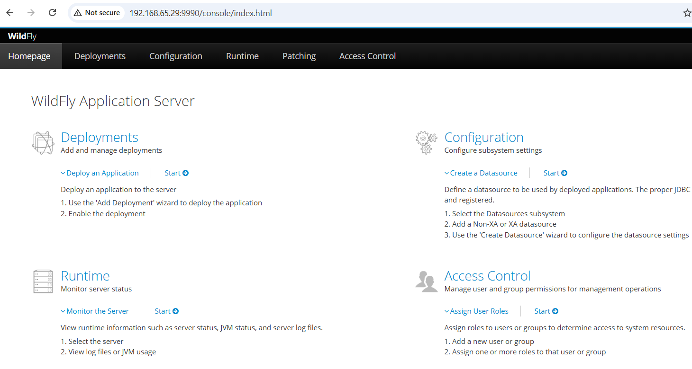
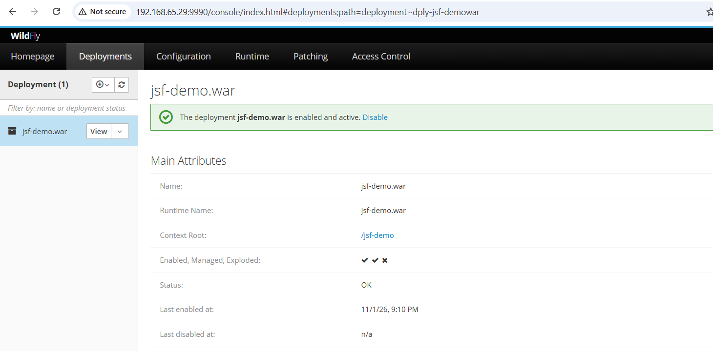

# Environment Setup

## Deploy Wildfly 24

Prepare an **Ubuntu 24.04** server (4 vCPUs, 4 GB RAM, 60 GB disk) and install Docker:

```shell
$ sudo apt update
$ sudo apt install docker.io docker-compose-v2 -y
```

Verify the environment:

```shell
$ lsb_release -a
No LSB modules are available.
Distributor ID: Ubuntu
Description:    Ubuntu 22.04.3 LTS
Release:        22.04
Codename:       jammy

$ docker --version
Docker version 29.1.3, build 29.1.3-0ubuntu3~22.04.2

$ docker compose version
Docker Compose version 2.40.3+ds1-0ubuntu1~22.04.1
```

Create a **Compose configuration file** named `wildfly.yaml`:

```yaml
version: '3.8'

services:
  wildfly-lab:
    image: jboss/wildfly:24.0.0.Final
    container_name: wildfly-lab
    restart: unless-stopped
    ports:
      - "8080:8080"   # HTTP web application access
      - "9990:9990"   # Management console & remote deployment
      - "8787:8787"   # JVM remote debugging (JDWP)
    command: >
      /opt/jboss/wildfly/bin/standalone.sh 
      -b 0.0.0.0 
      -bmanagement 0.0.0.0 
      --debug '*:8787'
```

Start the **container** and monitor the **boot logs**:

```shell
$ sudo docker compose -f wildfly.yaml up -d

$ sudo docker logs -f wildfly-lab
12:54:38,237 INFO  [org.jboss.as] (Controller Boot Thread) WFLYSRV0025: WildFly Full 24.0.0.Final (WildFly Core 16.0.0.Final) started in 7789ms - Started 319 of 558 services (344 services are lazy, passive or on-demand)
```

Create an **administrative management user**:

```shell
$ sudo docker exec -it wildfly-lab /opt/jboss/wildfly/bin/add-user.sh -u admin -p 'Avaya123$' -g admin
```

To **verify the setup**, open your browser and navigate to `http://192.168.65.29:9990` (replace with your server IP). Sign in with the credentials created above (`admin` / `Avaya123$`).



## Creating the Demo Project via Maven

In IntelliJ IDEA, create a new project via `New Module -> Java`:
- **Name**: `jsf-demo`
- **Build system**: `Maven`
- **JDK**: `11`

Once the project is initialized, configure the necessary project structure and resources:
- Update [`pom.xml`](https://github.com/yijun-l/jee/blob/main/jsf-demo/pom.xml) with the required JSF/CDI dependencies and packaging configurations.
- Create [`src/main/webapp/WEB-INF/beans.xml`](https://github.com/yijun-l/jee/blob/main/jsf-demo/src/main/webapp/WEB-INF/beans.xml) to enable CDI support.
- Configure [`src/main/webapp/WEB-INF/web.xml`](https://github.com/yijun-l/jee/blob/main/jsf-demo/src/main/webapp/WEB-INF/web.xml) to handle JSF (`.xhtml`) requests.
- Add the managed bean at [`src/main/java/io/github/yijun_l/HelloBean.java`](https://github.com/yijun-l/jee/blob/main/jsf-demo/src/main/java/io/github/yijun_l/HelloBean.java).
- Add the front-end view file at [`src/main/webapp/index.xhtml`](https://github.com/yijun-l/jee/blob/main/jsf-demo/src/main/webapp/index.xhtml).

To build the artifact, navigate to `Maven -> Lifecycle -> package`. Verify that `jsf-demo.war` is generated in the `target/` directory.

## Deploying the Application

Deploy the demo application to the WildFly instance on Ubuntu (`192.168.65.29`). Once deployed, verify access at `http://192.168.65.29:8080/jsf-demo/index.xhtml`.

### Option A: Via WildFly Admin Console

1. Open `http://192.168.65.29:9990` in your browser.
2. Sign in with your management credentials.
3. Go to `Deployments -> Manage Deployments -> Add (+)` and upload `target/jsf-demo.war`.
4. Enable the deployment.



### Option B: Via wildfly-maven-plugin

Add the `wildfly-maven-plugin` configuration to your `pom.xml`.

In the Maven tool window, go to `Plugins -> wildfly`:
- Run `wildfly:deploy` for the initial deployment. 
- Run `wildfly:redeploy` for subsequent codebase updates.

## Enabling Remote Debugging

In IntelliJ IDEA, go to `Edit Configurations...`, and create a new `Remote JVM Debug` configuration:

- **Name**: `WildFly-Remote-Debug`
- **Host**: `192.168.65.29`
- **Port**: `8787`
- **Use module classpath**: `jsf_demo`

Start the debugger. A successful connection will output: `Connected to the target VM, address: '192.168.65.29:8787', transport: 'socket'`

**Note on Firewalls**: If port 8787 is blocked by network policies, set up an SSH tunnel via your local terminal: `ssh -L 18787:127.0.0.1:8787 dadmin@192.168.65.29`. Then update the IntelliJ debug configuration to connect to **Host**: `127.0.0.1` and **Port**: `18787`.