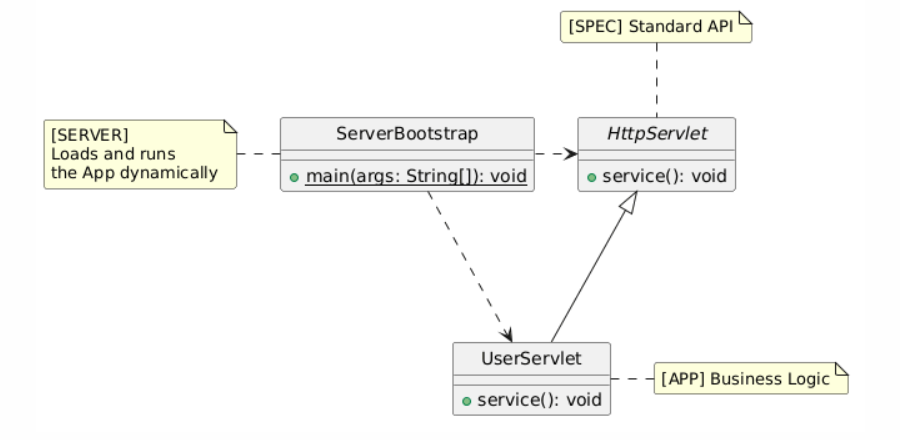

# Jakarta EE Application Server

## Jakarta EE

**Jakarta EE** is the open-source successor to **Java EE**. In 2017, Oracle transferred Java EE to the Eclipse Foundation to foster open community governance and faster innovation. Because Oracle retained the "Java" trademark, the platform was rebranded as Jakarta EE, shifting package namespaces from `javax.*` to `jakarta.*`.

Jakarta EE addresses three core challenges:

- **Vendor Lock-in**: Delivers vendor-neutral standards (CDI, JPA, Jakarta REST) to guarantee cross-runtime portability.
- **Modernization**: Adapts enterprise Java to containerized, microservice, and Kubernetes-native architectures.
- **Infrastructure Complexity**: Standardizes low-level plumbing (such as distributed transactions, messaging, and security) freeing developers to focus on core business logic.

### Core Capabilities

Jakarta EE provides a cohesive set of standardized enterprise specifications:

- **Dependency Injection & Lifecycle Management (CDI)**: Manages component lifecycles, loose coupling, and asynchronous events through type-safe dependency injection.
- **Persistence & Object-Relational Mapping (Jakarta Persistence / JPA)**: Maps relational data to Java objects, tracks entity states, and runs queries independently of database-specific SQL.
- **Web & REST Services (Jakarta REST & Servlet)**: Powers HTTP request processing, routing, content negotiation, and scalable microservice endpoints.
- **Enterprise Transactions & Messaging (Jakarta Transactions / JTA & Messaging / JMS)**: Guarantees ACID consistency across distributed data sources and enables asynchronous, event-driven messaging.
- **Security & Data Validation (Jakarta Security & Bean Validation)**: Unifies authentication, role-based access control (RBAC), and declarative data validation constraints.

### Mainstream Application Servers

A Jakarta EE application server implements these platform specifications, providing the runtime engine and managed system services for enterprise applications.

- **WildFly / JBoss EAP**: A fast, modular open-source server from Red Hat; JBoss EAP is its commercially supported enterprise distribution.
- **Open Liberty / WebSphere**: IBM's lightweight, container-first runtime (Open Liberty) and enterprise platform (WebSphere) optimized for hybrid clouds and microservices.
- **Payara Server**: A production-ready, cloud-friendly enterprise runtime evolved from GlassFish.
- **Apache TomEE**: A lightweight server integrating Jakarta EE enterprise profiles directly on an Apache Tomcat base.
- **Oracle WebLogic Server**: A commercial application server widely used in traditional, mission-critical enterprise systems.

## A simple Application Server

Here is a minimal example demonstrating how an application server interacts with deployed applications through inversion of control.



### Specification

A specification (like Jakarta EE) sets the standard rules. It provides a common base class or interface with a standard lifecycle method

```java
public abstract class HttpServlet {
    public void service() {
    }
}
```

### User Application

Developers write business logic by following this standard rule:

```java
public class UserServlet extends HttpServlet {
    @Override
    public void service() {
        System.out.println("[App]    - Hello from App!");
    }
}
```

### Server Runtime

The server does not know about user apps ahead of time. Instead, it reads the class name, loads the object with Java reflection, and calls the standard method:

```java
public class ServerBootstrap {
    public static void main(String[] args) throws Exception {

        String targetServletClass = "UserServlet";
        String contextPath = "/user";

        System.out.println("[Server] - Received request for path: " + contextPath);

        Class<?> clazz = Class.forName(targetServletClass);
        HttpServlet servlet = (HttpServlet) clazz.getDeclaredConstructor().newInstance();
        System.out.println("[Server] - Instantiated component via reflection: " + servlet.getClass().getName());

        System.out.println("[Server] - Invoking service() method...");
        servlet.service();
    }
}
```

### Output

When the server runs, it successfully loads and runs the app:

```shell
[Server] - Received request for path: /user
[Server] - Instantiated component via reflection: UserServlet
[Server] - Invoking service() method...
[App]    - Hello from App!
```